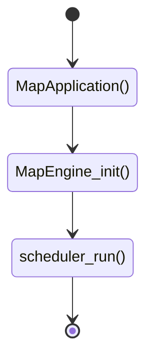
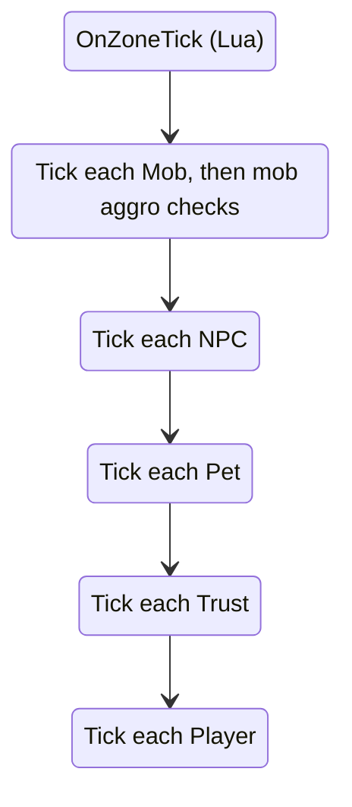

# Server Startup Tutorial

A quick tour of how `xi_map` starts up and runs. The other processes share the same `Application` base, but you're on your own with those. The snippets are trimmed down from the real code, so go read the files for the full picture.

## Entry point

`src/map/main.cpp` builds a `MapApplication` and calls `run()`:

```cpp
auto mapApp = std::make_unique<MapApplication>(argc, argv);
const auto success = mapApp->run();
```

The `Application` constructor (`src/common/application.cpp`) does the shared setup: logging, signal handlers, Lua, settings and the console. `MapApplication` (`src/map/map_application.cpp`) adds the map arguments (`--ip`, `--port`, `--lazy`, `--rebuild-navmeshes`) and its `run()` does this:

```cpp
engine_ = createEngine(); // A MapEngine
engine_->onInitialize();
registerCommands(console());

scheduler_.postToMainThread(mapEngine->init());

scheduler_.run(); // Blocks until shutdown
```



## The scheduler

There's no hand-written main loop. `Scheduler` (`src/common/scheduler/scheduler.h`) wraps an asio event loop on the main thread and a worker thread pool. Everything after startup is a task it runs: a timer firing, a UDP packet arriving or a coroutine resuming.

The ones you'll see most:

- `postToMainThread`/`postToWorkerThread`: queue work to run once.
- `intervalOnMainThread`: run work on a fixed period. It returns a token, and the timer stops when the token is destroyed.
- `spawnOnWorkerThread`: `co_await` work on the pool, then resume on the main thread.

## Engine init

`MapEngine::init()` in `src/map/map_engine.cpp` is a coroutine. It checks the database, calls `luautils::init`, starts the IPC client, loads items, spells, skills, recipes and the rest, then loads the zones with `zoneutils::Initialize`. After that it registers the regular tasks:

```cpp
mapCleanupToken_        = scheduler_.intervalOnMainThread(kSessionCleanupInterval, ...);    // 5s
mapGarbageCollectToken_ = scheduler_.intervalOnMainThread(kGarbageCollectionInterval, ...); // 15min, Lua GC
timeServerToken_        = scheduler_.intervalOnMainThread(kTimeServerTickInterval, ...);    // 2400ms, time_server
transportToken_         = scheduler_.intervalOnMainThread(kTransportTickInterval, ...);     // 400ms, ships and lifts
pumpIPCToken_           = scheduler_.intervalOnMainThread(kIPCPumpInterval, ...);           // 100ms, messages from xi_world
```

The intervals live in `src/map/map_constants.h`. Finally it calls `luautils::OnServerStart()` and starts the watchdog, which complains when a main thread tick runs long.

## Incoming packets

`MapSocket` (`src/map/map_socket.cpp`) listens for UDP and hands each datagram to `MapNetworking::handle_incoming_packet` (`src/map/map_networking.cpp`). That finds the session, decrypts the buffer and splits it into individual packets. Each packet goes to `PacketSystem::dispatch` (`src/map/packet_system.cpp`), which rate-limits it and calls the handler for that packet id. The reply goes back on the same socket.

Each client packet has its own file under `src/map/packets/c2s/`, for example `0x01a_action.cpp`. A handler has a `validate` step, which checks what the client sent (never trust it), and a `process` step that does the work.

## Zone ticks

`zoneutils::Initialize` loads every zone assigned to the process, with its NPCs and mobs, then calls `CZone::createZoneTimers()` on each one. That registers three intervals per zone:

- `ZoneServer` every 400ms (`kLogicUpdateInterval`). This is the logic tick.
- `CheckTriggerAreas` every 200ms.
- The spawn handler every 30s.

`CZoneEntities::ZoneServer` (`src/map/zone_entities.cpp`) ticks each entity list in turn:



Pass `--lazy` to load zones on demand instead. Handy while developing, when you don't want to wait for all of Vana'diel to load.

## Lua scripting

While poking around in the core you'll see a lot of calls to `luautils::<something>`. These go into the Lua scripting system. Core objects (entities, zones, items and so on) are wrapped in a Lua object and passed into scripts. The wrappers expose functions you can call on the object from Lua.

The bindings live in `src/map/lua/luautils.cpp` and `src/map/lua/lua_base_entity.cpp`, with a file per wrapper type under `src/map/lua/`.

### Example

- `charutils.cpp` calls `luautils::OnPlayerLevelUp(PChar)` when the player levels up.
- That calls the global Lua function `xi.player.onPlayerLevelUp`, in `scripts/globals/player.lua`.
- The player is wrapped for Lua and passed in as the `player` argument.
- Errors in the Lua script are caught and logged.

## Some things of note

- Game logic runs on the main thread. We send some work to the worker pool, but we _very much on purpose_ keep threading to a minimum. This protects us from a whole category of bugs that are hard to diagnose and fix. See [Programming for Performance](Programming-for-Performance).

- To scale once the workload gets high, you can run several `xi_map` processes and assign different zones to each. They exchange messages through `xi_world` over ZMQ. Until you have 100+ concurrent users, you don't have to think about this.
